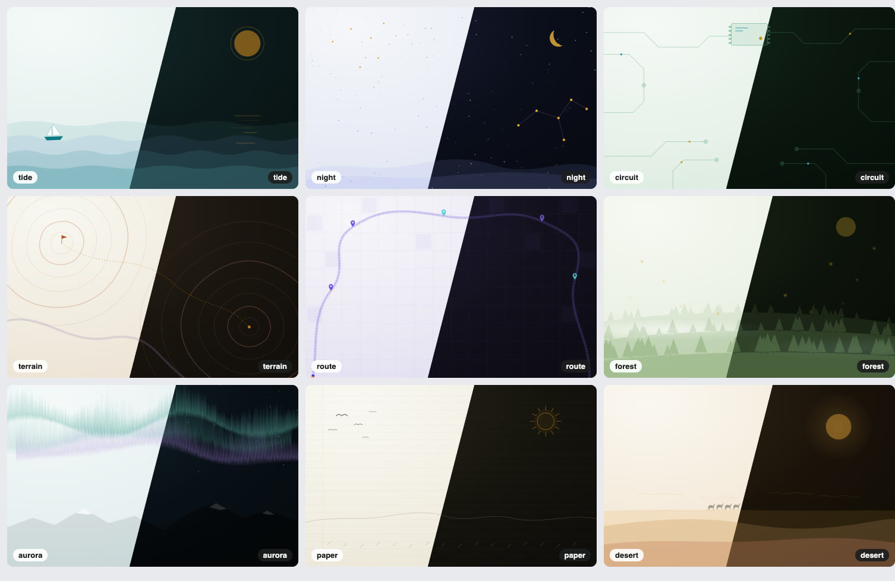

# Project Scener

Give every project its own look in the Claude desktop app: a slow, moving backdrop with matching colors behind the conversation. With several sessions open, you can tell at a glance which project you are in.



It is a plugin for [Claude Code](https://claude.com/claude-code). Looks are drawn by the Claude desktop app alone: the mobile app does not draw them, and in a terminal or an editor the plugin does nothing. `/scene` says where the session is open.

## Install

In a terminal session, at the prompt:

```
/plugin install project-scener --marketplace alihaluk/project-scener
```

Or from a shell:

```bash
claude plugin install project-scener --marketplace alihaluk/project-scener
```

In the desktop app: click **+** next to the prompt box, then **Plugins**, **Add marketplace** with `alihaluk/project-scener`, then **Add plugin**.

## Use

Open a project and type:

```
/scene tide
```

That project now has the Tide look, in every session, until you change it. A git worktree shares the look of its repository.

| Command | What it does |
| --- | --- |
| `/scene` | Shows this project's look and lists the looks |
| `/scene <look>` | Picks a look for this project |
| `/scene off` | No look for this project |
| `/scene reset` | Forgets your pick, back to the project's own look or your default |
| `/scene <setting> <value>` | Changes one of the settings below, like `/scene ripples off` |

### The looks

| Look | Scene |
| --- | --- |
| `tide` | A slow sea swell and a small boat, in teal |
| `night` | Twinkling stars, constellations and a crescent moon, in indigo |
| `circuit` | A circuit board with signals travelling its traces, in green |
| `terrain` | A contour map with a trail between two summits, in warm earth |
| `route` | A delivery van driving a city route, in violet |

Every look follows light and dark mode, and stands still for people who have asked their system for reduced motion.

In the desktop app each look also has a quiet sound of its own and draws your messages in its own bubbles. The sound stays off until you press the speaker in the session's title bar.

Click the bare backdrop and the look answers: in the desktop app a ripple spreads from where you pressed, gone within a second. Tide sends a wave, Night a star's glint, Circuit a square pulse along the board, Terrain a contour line and Route a ping.

The desktop app stops a ripple that flashes: one where a spot lights up more than three times a second. A ripple reaches a spot later the farther it is from where you pressed, so two clicks a little apart can light the same spot twice in a tenth of a second, however slowly you click. So the backdrop remembers when each spot was last lit fully: a ripple that would light it again within about 0.6 seconds passes there as a faint echo, too faint to count as a flash. Every click gets a ripple, up to six a second. A click changes nothing but the ripple: the scene is never sent again for it, since a scene sent again starts its animations over, and the app would take that jump for a flash too.

### Settings

These are the plugin's options and apply to every project. `/scene` shows them. Change one with `/scene <setting> <value>`, in the desktop app too, or in `/config` in a terminal session: both write the same options.

| Option | `/scene` | What it does |
| --- | --- | --- |
| **Default look** | `default <look>` or `default none` | The look of projects you have not picked one for. Left at `none`, they stay as the app draws them |
| **Sound** | `sound on`, `sound cues`, `sound off` | The whole sound, its short cues without the ambience, or none |
| **Sound level** | `level quiet`, `level normal`, `level loud` | How loud, beside the app's own volume |
| **Message style** | `style on`, `style off` | Off, your messages keep the app's own look |
| **Ripples** | `ripples on`, `ripples off` | Off, a press on the backdrop plays no ripple |

`/scene level` with no value says what it is now and what it takes.

## A look of the project's own

A project can carry its look in its repository, so everyone on the team with the plugin sees it. The easy way is to ask Claude:

> Design a scene for this project

Claude looks at the project's brand colors and what it does, then writes the two files below. Run `/scene` to see the result.

By hand, put a `.claude/scene.json` in the project:

```json
{ "look": "tide" }
```

or a shipped scene in your own colors:

```json
{
  "label": "Storefront",
  "scene": "circuit",
  "colors": { "accent": "#e11d48" }
}
```

or your own art, an SVG beside the file:

```json
{
  "label": "Storefront",
  "scene": "scene.svg",
  "alt": "Parcels moving along a conveyor belt",
  "colors": {
    "accent": "#e11d48",
    "light": { "background": "#f4ecee", "text": "#2a1a1e" },
    "dark": { "background": "#1a1114", "text": "#f3e6e9" }
  },
  "sound": "circuit",
  "style": "circuit",
  "ripple": "circuit"
}
```

| Field | What it is |
| --- | --- |
| `look` | A shipped look to start from; the other fields override parts of it |
| `label` | The look's name |
| `scene` | A shipped scene's name, an SVG file inside `.claude`, or `none` for colors alone |
| `alt` | What the scene shows, for a screen reader |
| `colors` | Six-digit hex: `accent`, `danger`, `success`, `warning`, `pro`, and `light` / `dark` with `background` and `text` |
| `glass` | How the app frosts its panels over the scene: `{ "blur": 18, "opacity": 0.62 }`, or `false` |
| `sound` | A shipped look's sound (`"night"`), `"none"`, or a sound of your own. Left out, a shipped scene brings its own, and your own art is silent |
| `style` | How the desktop app draws messages: a shipped look's (`"circuit"`), `"none"` for the app's own, or a style of your own. Left out, as for `sound` |
| `ripple` | What answers a click on the bare backdrop: a shipped look's ripple (`"tide"`), played over your scene in your `accent`, or `"none"`. Left out, as for `sound` |

A scene SVG animates with CSS in its own `<style>`, runs no script and loads nothing, and can be up to 131,072 characters. [skills/design-scene/SKILL.md](skills/design-scene/SKILL.md) has the full guide, with how to write a sound and a style of your own. Asked to design a scene, Claude gives it a sound, a style and a ripple too.

When a file has a mistake, `/scene` says what is wrong, and nothing is drawn until it is fixed.

### Which look wins

1. Your own pick for the project (`/scene <look>` or `/scene off`)
2. The project's `.claude/scene.json`
3. Your default look
4. Otherwise, the app's own look

## Good to know

- There is one theme per session: if another plugin sets a theme too, the last one to set it wins.
- A look is decoration: when anything goes wrong the plugin draws nothing and never holds up a turn.
- Sound, message styles and the ripples are the desktop app's alone; the ripples stand still for reduced motion, like the scenes. Your accessibility settings win over a style: an accessibility font or higher contrast draws plain rows.
- A Claude Code too old for sounds and styles still draws the look's colors and scene, and `/scene` says what was left out.

## Privacy

Project Scener collects nothing and sends nothing anywhere.

- It makes no network requests, runs no programs and calls no model.
- A look's sound is a list of numbers that the desktop app turns into sound itself: the plugin ships no audio file and plays nothing on its own.
- It reads two things from the project: `.claude/scene.json` and the SVG that file names. It writes no files of its own: `/scene <setting> <value>` asks Claude Code to change the plugin's option, which Claude Code keeps in its own settings, as `/config` does.
- Your picks (a project's folder path and the name of its look) are kept on your machine, in the plugin's own store. Uninstalling the plugin removes them.
- It does not read your conversations, your code or your account, and it reads no credential, key or token.

### What the code calls

Everything the plugin does goes through Claude Code's own plugin interface (`$`), on your machine:

| Call | What it does |
| --- | --- |
| `$.theme.set`, `$.theme.clear` | Sets or removes the session's theme (the colors, the backdrop, the sound and the message style) in the Claude app. This is Claude Code's own theme call, not one from another plugin; nothing is sent anywhere. |
| `$.fs.exists`, `$.fs.read` | Reads `.claude/scene.json` and the SVG it names, in the project folder |
| `$.session.cwd`, `$.session.repo` | Finds the project folder, so a git worktree shares its repository's look |
| `$.session.surfaces` | Lists where the session is open (`desktop`, `mobile`), for `/scene` to say |
| `$.store.get`, `$.store.set` | Keeps your picks on your machine |
| `$.config.list`, `$.config.set` | Finds this plugin's own options and changes one, for `/scene <setting> <value>`. It touches no other row |
| `$.command.register`, `$.ui.toast`, `$.ui.resolve`, `$.ui.invalidate` | The `/scene` command, a notice when a project file has a mistake, drawing the backdrop, and drawing it again when a setting changes |

The plugin hooks the session starting, a client attaching and each turn starting, only to learn which folder the session is in and to send the look to a client that has just joined. It never reads a message, a prompt or a tool's output.

The ripples are small shader files in `hooks/shaders`. The plugin never runs them: Claude Code checks each one, and the desktop app plays it on the GPU, fed only the time and where you press. Each keeps its last six ripples in a buffer of six pixels, and when each patch of 12 points last lit up fully in a small buffer of its own, so no spot lights up fully twice within 0.6 seconds.

`hooks/make-colors.js` is Claude Code's theme builder, copied unchanged as Claude Code ships it for theme plugins. Its long hex strings are its stock color palettes, written as data; they are not encoded code.

The only URL in the code is `http://www.w3.org/2000/svg` in `hooks/scenes/kit.ts`: the SVG namespace every scene's `<svg>` tag must name. It is an identifier, never fetched; the app draws the scene with no network access.

## Support

Questions, problems and ideas for new looks: [open an issue](https://github.com/alihaluk/project-scener/issues).

## Develop

```bash
claude --plugin-dir . --debug     # run it from this folder, reloading on save
claude plugin validate .          # check the manifest and the hooks module
claude plugin test .              # run tests/
```

| Path | What is there |
| --- | --- |
| `hooks/register.tsx` | The hooks: when a look is applied, the `/scene` command, drawing the backdrop |
| `hooks/config.ts` | Reads a project file and turns a look into a theme |
| `hooks/looks.ts` | The shipped looks and their palettes |
| `hooks/scenes/` | One file per scene, each drawn from a palette; `kit.ts` is what they share |
| `hooks/make-colors.js` | Claude Code's theme builder, copied as it ships; do not edit |
| `skills/design-scene/` | The guide Claude follows to design a project's own look |

To add a look: draw a scene in `hooks/scenes/` (copy `tide.ts`), list it in `SCENES` in `hooks/looks.ts`, add a look with its palette to `LOOKS`, and add its name to `defaultLook` in `.claude-plugin/plugin.json`.

## Türkçe

Project Scener, Claude masaüstü uygulamasında her projeye kendi görünümünü verir: sohbetin arkasında yavaşça hareket eden bir sahne ve ona uyan renkler. Birden çok oturum açıkken hangi projede olduğunuzu bir bakışta anlarsınız.

Masaüstü uygulamasında her görünümün ayrıca sakin bir sesi ve mesajlarınız için kendi balon stili var. Ses, oturumun başlık çubuğundaki hoparlöre basana kadar kapalı kalır. Arka planın boş bir yerine tıkladığınızda görünüm cevap verir: Tide bir dalga halkası, Night bir yıldız parıltısı, Circuit ızgara boyunca kare bir sinyal, Terrain bir eş yükselti çizgisi, Route da bir konum işareti gönderir. Uygulama yanıp sönen efektleri durdurduğu için, aynı yere kısa sürede ikinci kez gelen halka orada soluk geçer.

- `/scene`: projenin görünümünü ve hazır görünümleri gösterir
- `/scene tide`: bu projeye bir görünüm seçer (`tide`, `night`, `circuit`, `terrain`, `route`)
- `/scene off`: bu projede görünümü kapatır
- `/scene reset`: seçiminizi unutur
- `/scene <ayar> <değer>`: bir ayarı değiştirir, masaüstü uygulamasında da: `/scene sound off` (ses), `/scene level quiet` (ses düzeyi), `/scene style off` (mesaj stili), `/scene ripples off` (tıklama halkaları), `/scene default tide` (seçim yapılmamış projelerin görünümü)

Projeye özel bir görünüm için Claude'a "bu proje için bir sahne tasarla" demeniz yeterli; Claude `.claude/scene.json` ve `.claude/scene.svg` dosyalarını yazar. Görünüme hazır görünümlerden uygun bir ses, mesaj stili ve tıklama halkası da seçer ve nedenini söyler. Bunlar `scene.json` içindeki `sound`, `style` ve `ripple` alanlarıdır; projenin kendi çiziminin üstündeki halka, projenin vurgu rengiyle oynar.

## License

[MIT](LICENSE)
