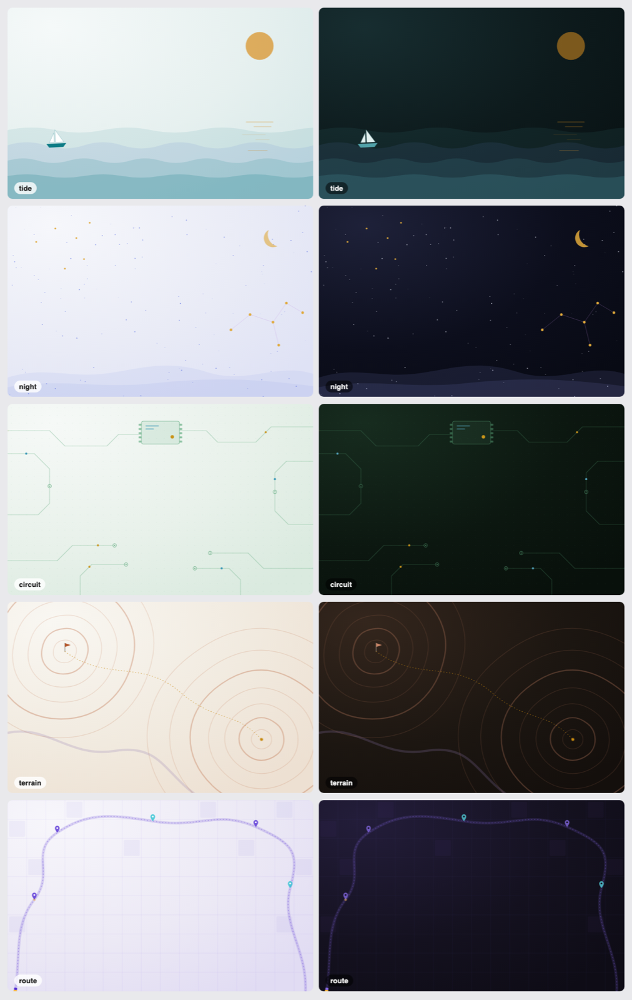

# Project Scener

Give every project its own look in the Claude desktop and mobile apps: a slow, moving backdrop with matching colors behind the conversation. With several sessions open, you can tell at a glance which project you are in.



It is a plugin for [Claude Code](https://claude.com/claude-code). Looks are drawn by the Claude desktop and mobile apps; in a terminal or an editor the plugin does nothing.

## Install

In a terminal session, at the prompt:

```
/plugin install project-scener --marketplace alihaluk/project-scener
```

Or from a shell:

```bash
claude plugin install project-scener --marketplace alihaluk/project-scener
```

In the desktop app: click **+** next to the prompt box, then **Plugins**, **Add marketplace** with `alihaluk/project-scener`, then **Add plugin**.

## Use

Open a project and type:

```
/scene tide
```

That project now has the Tide look, in every session, until you change it. A git worktree shares the look of its repository.

| Command | What it does |
| --- | --- |
| `/scene` | Shows this project's look and lists the looks |
| `/scene <look>` | Picks a look for this project |
| `/scene off` | No look for this project |
| `/scene reset` | Forgets your pick, back to the project's own look or your default |

### The looks

| Look | Scene |
| --- | --- |
| `tide` | A slow sea swell and a small boat, in teal |
| `night` | Twinkling stars, constellations and a crescent moon, in indigo |
| `circuit` | A circuit board with signals travelling its traces, in green |
| `terrain` | A contour map with a trail between two summits, in warm earth |
| `route` | A delivery van driving a city route, in violet |

Every look follows light and dark mode, and stands still for people who have asked their system for reduced motion.

### A default look

Projects you have not picked a look for stay as the app draws them. To give them all one look, set **Default look** in the plugin's options (`/config` in a terminal session).

## A look of the project's own

A project can carry its look in its repository, so everyone on the team with the plugin sees it. The easy way is to ask Claude:

> Design a scene for this project

Claude looks at the project's brand colors and what it does, then writes the two files below. Run `/scene` to see the result.

By hand, put a `.claude/scene.json` in the project:

```json
{ "look": "tide" }
```

or a shipped scene in your own colors:

```json
{
  "label": "Storefront",
  "scene": "circuit",
  "colors": { "accent": "#e11d48" }
}
```

or your own art, an SVG beside the file:

```json
{
  "label": "Storefront",
  "scene": "scene.svg",
  "alt": "Parcels moving along a conveyor belt",
  "colors": {
    "accent": "#e11d48",
    "light": { "background": "#f4ecee", "text": "#2a1a1e" },
    "dark": { "background": "#1a1114", "text": "#f3e6e9" }
  }
}
```

| Field | What it is |
| --- | --- |
| `look` | A shipped look to start from; the other fields override parts of it |
| `label` | The look's name |
| `scene` | A shipped scene's name, an SVG file inside `.claude`, or `none` for colors alone |
| `alt` | What the scene shows, for a screen reader |
| `colors` | Six-digit hex: `accent`, `danger`, `success`, `warning`, `pro`, and `light` / `dark` with `background` and `text` |
| `glass` | How the app frosts its panels over the scene: `{ "blur": 18, "opacity": 0.62 }`, or `false` |

A scene SVG animates with CSS in its own `<style>`, runs no script and loads nothing, and can be up to 131,072 characters. [skills/design-scene/SKILL.md](skills/design-scene/SKILL.md) has the full guide.

When a file has a mistake, `/scene` says what is wrong, and nothing is drawn until it is fixed.

### Which look wins

1. Your own pick for the project (`/scene <look>` or `/scene off`)
2. The project's `.claude/scene.json`
3. Your default look
4. Otherwise, the app's own look

## Good to know

- There is one theme per session: if another plugin sets a theme too, the last one to set it wins.
- A look is decoration: when anything goes wrong the plugin draws nothing and never holds up a turn.

## Privacy

Project Scener collects nothing and sends nothing anywhere.

- It makes no network requests, runs no programs and calls no model.
- It reads two things from the project: `.claude/scene.json` and the SVG that file names. It writes no files.
- Your picks (a project's folder path and the name of its look) are kept on your machine, in the plugin's own store. Uninstalling the plugin removes them.
- It does not read your conversations, your code or your account.

## Support

Questions, problems and ideas for new looks: [open an issue](https://github.com/alihaluk/project-scener/issues).

## Develop

```bash
claude --plugin-dir . --debug     # run it from this folder, reloading on save
claude plugin validate .          # check the manifest and the hooks module
claude plugin test .              # run tests/
```

| Path | What is there |
| --- | --- |
| `hooks/register.tsx` | The hooks: when a look is applied, the `/scene` command, drawing the backdrop |
| `hooks/config.ts` | Reads a project file and turns a look into a theme |
| `hooks/looks.ts` | The shipped looks and their palettes |
| `hooks/scenes/` | One file per scene, each drawn from a palette; `kit.ts` is what they share |
| `hooks/make-colors.js` | Claude Code's theme builder, copied as it ships; do not edit |
| `skills/design-scene/` | The guide Claude follows to design a project's own look |

To add a look: draw a scene in `hooks/scenes/` (copy `tide.ts`), list it in `SCENES` in `hooks/looks.ts`, add a look with its palette to `LOOKS`, and add its name to `defaultLook` in `.claude-plugin/plugin.json`.

## Türkçe

Project Scener, Claude masaüstü ve mobil uygulamalarında her projeye kendi görünümünü verir: sohbetin arkasında yavaşça hareket eden bir sahne ve ona uyan renkler. Birden çok oturum açıkken hangi projede olduğunuzu bir bakışta anlarsınız.

- `/scene`: projenin görünümünü ve hazır görünümleri gösterir
- `/scene tide`: bu projeye bir görünüm seçer (`tide`, `night`, `circuit`, `terrain`, `route`)
- `/scene off`: bu projede görünümü kapatır
- `/scene reset`: seçiminizi unutur

Projeye özel bir görünüm için Claude'a "bu proje için bir sahne tasarla" demeniz yeterli; Claude `.claude/scene.json` ve `.claude/scene.svg` dosyalarını yazar.

## License

[MIT](LICENSE)
